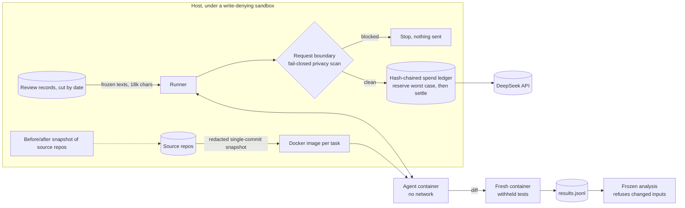

# The 125-run memory replay

Does giving a coding agent the lessons from earlier code reviews stop it repeating a mistake it really made before?
This is the design, the controls and the results of the final experiment. The pre-registered analysis is
[`../replay/ANALYSIS.md`](../replay/ANALYSIS.md), frozen at tag `replay-analysis-frozen-14` (`e547285`), and every
number below comes from [`../results/replay-analysis.json`](../results/replay-analysis.json) unless noted.

This public copy leaves out the memory texts and the task code and tests (patches, withheld tests, inputs), which come
from private projects, so the replay cannot be rerun from it. Paths below that point there describe the original run.

## Design

| Part | Choice |
|---|---|
| Tasks | 5 TypeScript tasks from the author's own agent-built projects, each built around a mistake a reviewer had flagged earlier. For lock, verifier and onnx the agent's real earlier attempt is kept as a control |
| Conditions | `none`, `instructions` (one general build brief shared across projects), `retrieved` (BM25 over earlier review records), `oracle` (the two hand-picked lessons, padded with random records), `random` (same size, no hand-picked record) |
| Memory size | 17.4k to 18.0k characters for the three record-based conditions, so they cost about the same |
| Time cutoff | a review record counts only if it existed before the task's starting commit (file birth time and change time) |
| Seeds | 1 to 5, one run per task × condition × seed: 125 runs. Seeds change only which random records fill the memory |
| Model and agent | DeepSeek Flash (`deepseek-flash`), mini-swe-agent 2.4.6, same prompt template for every run |
| Limits per run | 60 steps, $0.08, 30 minutes. Observed maximum: 40 steps, $0.0735, 546 s |
| Outcomes | **avoided** (primary): task tests, every regression test and the memory tests pass. **pass**: task and regression tests pass. Tests only, no model judge |
| Primary set | lock, verifier, onnx, fczero. simlink is reported apart, because its lesson is the task itself |
| Comparisons | oracle vs none, retrieved vs none, oracle vs random |
| Statistics | per-task rates with Wilson intervals, exact sign-flip test over the 4 tasks (16 patterns) with Holm adjustment, 95% bootstrap (10,000 resamples, seed 20261117, tasks then seeds) |
| Reading, fixed in advance | "consistent benefit" needs a positive difference in at least 3 of 4 tasks and an interval above 0. "Consistent harm" is the mirror. Anything else is "no clear effect" |

With four tasks the smallest possible p-value is 0.125, so no comparison could reach 0.05. That was known and written
down before the first paid call. This is an exploratory case study.

### The tasks

| Task | The repeated mistake | Lesson already in the repo at the start? |
|---|---|---|
| lock | the wrong row-lock strength in a worker query | yes, a comment names the right lock |
| verifier | a lock query whose database client is not released on every path | yes, another job releases it in `finally` |
| simlink | a path check that symlinks can escape | no, but the task asks for exactly that |
| onnx | accepting model metadata without checking its full shape | yes, the older model's loader checks it |
| fczero | reporting "reproduced" or "clean" from zero replays, and overwriting results after a harness error | no |

Each task was checked at $0, 3 of 3 times. For all five, the untouched code fails and the real fix passes and avoids
the mistake. The other controls differ per task (`replay/tasks/<task>/patches/`):

| Task | Real earlier attempt | Task-only fix (passes, fails the memory test) | Memory-only fix (fails the task) |
|---|---|---|---|
| lock | passes the task, repeats the mistake | | |
| verifier | passes the task, repeats the mistake | | |
| simlink | | not applicable, the lesson is the task | yes |
| onnx | fails one task test, repeats the mistake | yes | yes |
| fczero | | yes | yes |

## Data flow and controls

| Risk | Control |
|---|---|
| The agent sees the future | Snapshots have one neutral commit, no history, refs or remotes. Memory is cut before each task's start |
| Private text leaves the machine | Docs in snapshots are redacted. Every outgoing request, the whole conversation and tool output included, is scanned and blocked on a match, never retried. A post-run transcript audit checks again |
| The experiment writes into real repositories | A host sandbox denies writes, containers have no host mounts, and a before/after snapshot of every file (ignored files and caches included) must match |
| The agent games the grading | Withheld tests are written over the agent's own test files, regression tests are restored, and every diff was checked for edits to test configuration. None found |
| Spend overruns | Every request reserves its worst case under an exclusive lock before it is sent and settles after. The ledger never resets across folders or freezes. A stop file and journaled halts can only be cleared by a person |
| The design drifts after results appear | `FROZEN.json` hashes every input, image and installed package. The runner and the analysis refuse to run on any change |

The design went through 14 freezes before the grid, all before any counted run. Freezes 1 to 3 came from
pre-registration reviews and refined the analysis rules (crashes counted as missing, at least 3 complete seeds,
extra reported metrics). Freeze 4 was the privacy repair, 5 to 13 followed second-model review rounds (mostly spend and
failure handling, and in freeze 12 scoring runs that hit the model's context limit), and 14 was a base-image lookup
fix. No freeze changed the tasks, memory texts, conditions, seeds, tests or the three comparisons
([`../replay/REVISIONS.md`](../replay/REVISIONS.md)).

## Results

### Task success

All 125 counted runs passed their task and regression tests. Memory could not raise task success above 100%.

### Avoiding the repeated mistake

Runs that avoided it, out of 5:

| Task | None | Instructions | Retrieved | Oracle | Random |
|---|---:|---:|---:|---:|---:|
| lock | 5 | 5 | 4 | 5 | 5 |
| verifier | 5 | 5 | 5 | 5 | 5 |
| onnx | 2 | 1 | 5 | 2 | 2 |
| fczero | 0 | 0 | 0 | 0 | 0 |
| simlink | 5 | 5 | 5 | 5 | 5 |

### Primary comparisons

| Comparison | lock | verifier | onnx | fczero | Mean | 95% bootstrap | p (Holm) | Reading |
|---|---:|---:|---:|---:|---:|---|---:|---|
| oracle vs none | 0 | 0 | 0 | 0 | 0.00 | [-0.15, 0.15] | 1.0 | no clear effect |
| retrieved vs none | -0.2 | 0 | +0.6 | 0 | +0.10 | [-0.20, 0.45] | 1.0 | no clear effect |
| oracle vs random | 0 | 0 | 0 | 0 | 0.00 | [-0.15, 0.15] | 1.0 | no clear effect |

### What the runs show

These readings come from the diffs and transcripts, read by the author and independently by the results reviewer.

- **Ceiling (lock, verifier, and simlink outside the primary set).** The agent avoids these mistakes without memory. The repository already shows
  the right pattern, or the task asks for it. The one miss, `lock.retrieved.4`, used `FOR UPDATE` and failed the
  memory test for real.
- **Floor (fczero).** No run fixed the two defects, even with the hand-picked lesson in context. The tested functions
  already exist in the repository, so the tests are fair. The lesson is one line inside long review records about
  another project, and it does not spell out this task's exact behaviour. In `fczero.oracle.5` the agent considered
  it, then gave priority to the explicit request in the task.
- **onnx.** Retrieved memory avoided the mistake 5 of 5 times, every other condition 1 or 2. Retrieved runs cite the
  "validate the full shape" lesson. Oracle runs, which hold the same lesson, left the version or threshold check out.
  One task, 5 seeds per cell, and a lesson already present in the repository: a hint for a follow-up, not a finding.

### Retrieval

BM25 rank of the two hand-picked lessons among each task's earlier review records:

| Task | Ranks | Useful lesson inside the retrieved text? |
|---|---|---|
| lock | 22, 24 | no |
| verifier | 29, 45 | no |
| simlink | 42, 5 | no (the 5th-ranked record most likely did not fit the 18k budget, not checked) |
| onnx | 2, 5 | yes, one (the second is cut off after its heading) |
| fczero | 14, 51 | no |

Keyword retrieval over raw review records found the useful lesson for one task of five.

### Process and cost

Means over the 25 runs of each condition:

| Condition | Input tokens | Cached input | Output tokens | Steps | Seconds | Cost |
|---|---:|---:|---:|---:|---:|---:|
| none | 540,223 | 511,621 | 16,530 | 22.4 | 240 | $0.0323 |
| instructions | 707,755 | 674,125 | 18,378 | 23.9 | 274 | $0.0380 |
| retrieved | 599,660 | 572,534 | 16,453 | 22.4 | 223 | $0.0327 |
| oracle | 759,523 | 726,436 | 18,653 | 25.1 | 266 | $0.0373 |
| random | 748,012 | 713,672 | 18,387 | 24.5 | 248 | $0.0372 |

The instructions, oracle and random texts cost 15 to 18% more per run than no memory, retrieved about 1% more, with
no clear effect detected. Token counts leave out 32 paid
responses that followed format errors (a known gap in the frozen analysis). Costs come from the ledger and are
complete.

| Cost item | USD |
|---|---:|
| 125 counted runs | 4.438 |
| 2 crashed runs (kept as diagnostic records) | 0.040 |
| ledger reconciliation and rounding | 0.001 |
| grid total (ledger) | 4.480 |
| smoke request | 0.001 |
| excluded first paid run | 0.047 |
| **cumulative, of a $10 cap** | **4.528** |

The ledger counts at peak prices and never less than the account balance moved. The balance fell by $4.11 over the
grid, in cent steps.

## Limitations

- Four primary tasks, one model, one agent configuration. It cannot show that memory helps, or that it does not, in general.
- Three of the four primary tasks already carry the lesson in the repository, and two of them (lock, verifier) are at
  the ceiling. The task where memory adds new information is at the floor.
- Memory here is raw review records, not distilled lessons, and retrieval is plain BM25.
- Two reporting gaps in the frozen analysis, left unchanged: no bootstrap intervals for the secondary comparisons, and
  token counts that miss 32 format-error responses.
- The two interrupted seed-5 simlink runs were retried once, as the plan allows. The excluded first paid run is kept
  apart as a diagnostic record.
- The per-run rows (`results.jsonl`), diffs and transcripts live outside this repository.
